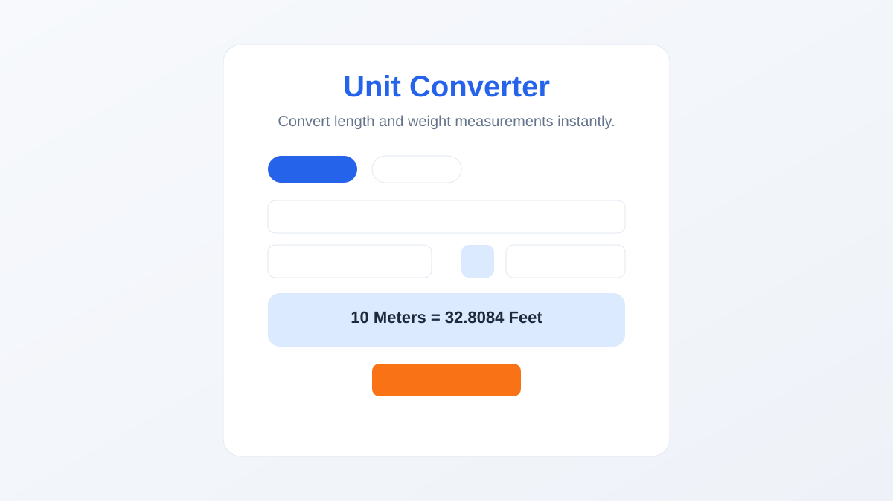
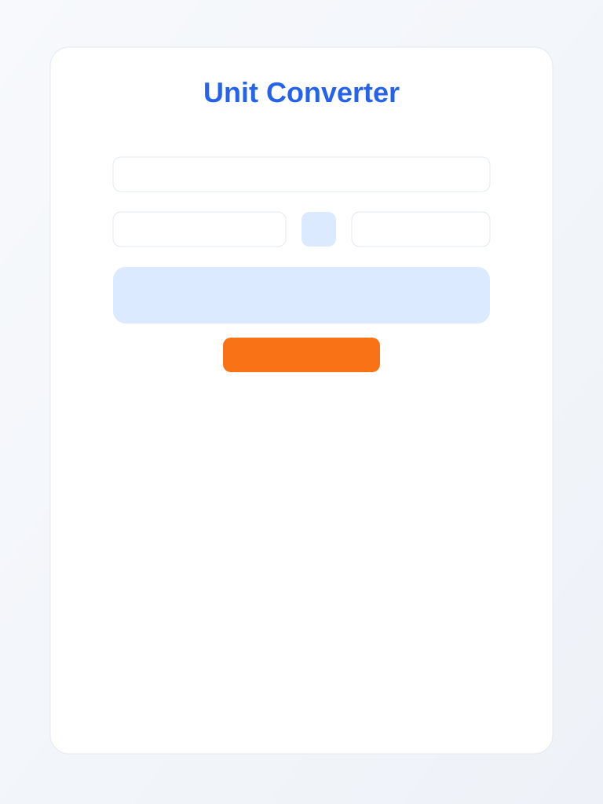
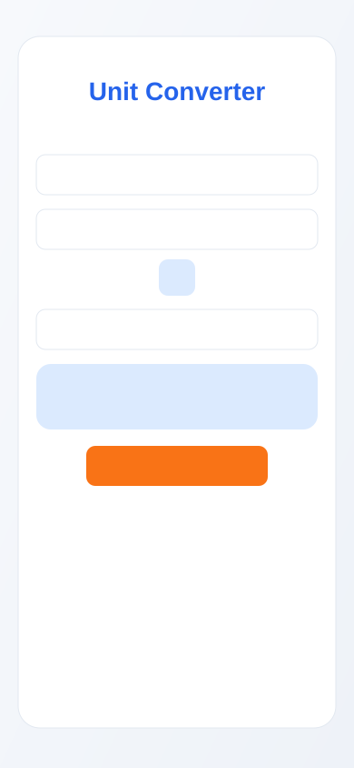

<div align="center">
  

  

  <p><b>Light Theme &#183; Blue &amp; Orange Accents &#183; Responsive &#183; Accessible</b></p>

  
  
  
  
  
  

</div>

---

<div align="center">
  
</div>

Unit Converter by **Abhishek Jadhav** &mdash; Web Developer and first-year BCA student at VIIT, Baramati. Built with **HTML5 + CSS3 + Vanilla JavaScript**: convert length and weight measurements instantly as you type, swap source and target units, and reset to the default state. No frameworks, no build step, no backend.

> **Internship attribution:** 45-day Web Development Internship at **Veda Technology** &mdash; Day 15: Unit Converter.

<details>
<summary><b>Table of Contents (click to expand)</b></summary>

- [Features](#-features)
- [Technologies](#-technologies)
- [Conversion Approach](#-conversion-approach)
- [Accessibility](#-accessibility)
- [Project Structure](#-project-structure)
- [How to Run](#-how-to-run)
- [Profile Links](#-profile-links)
- [Screenshots](#-screenshots)
- [Testing Checklist](#-testing-checklist)
- [Deployment](#-deployment)
- [Limitations](#-limitations)

</details>

## Features

<div align="center">
  
</div>

- **Length converter** &mdash; millimeters, centimeters, meters, kilometers, inches, feet, yards, miles.
- **Weight converter** &mdash; milligrams, grams, kilograms, metric tons, ounces, pounds, stones.
- **Category tabs** &mdash; switch between Length and Weight instantly.
- **Instant results** &mdash; updates as you type or change units.
- **Swap Units** &mdash; reverses source and target units.
- **Reset** &mdash; restores the default state.
- **Clear result line** &mdash; e.g. `10 Meters = 32.8084 Feet`.
- **Safe input handling** &mdash; empty, invalid, zero, negative, and very large numbers.
- **Accurate factors** &mdash; no rounding of intermediate calculations.
- **Smart formatting** &mdash; up to 6 decimals, trailing zeros removed.
- **Responsive layout** &mdash; works on mobile, tablet, and desktop.
- **Accessible** &mdash; labels, keyboard navigation, visible focus states, reduced motion.

---

## Technologies

| Technology | Use |
|------------|-----|
|  | Semantic structure, tabs, controls, footer (`index.html`) |
|  | Custom properties, Grid, Flexbox, `clamp()`, animations, media queries, reduced-motion (`style.css`) |
|  | Conversion logic, formatting, event listeners (`script.js`) |
|  | Zero dependencies |
|  | Segoe UI / system stack (no web-font request) |

---

## Conversion Approach

- Length values are converted to **meters** first, then to the target unit.
- Weight values are converted to **kilograms** first, then to the target unit.
- All factors live in clear JavaScript configuration objects.
- Intermediate calculations keep full precision; `toFixed()` is used only for display.
- Results are formatted to up to 6 decimal places with unnecessary trailing zeros removed.

---

## Accessibility

- Semantic landmarks: `main`, `section`, `header`, `footer`.
- One `<h1>` for the page title.
- Accessible names on every control via `<label>` and `aria-label`.
- `role="status"` and `aria-live` regions for the result and messages.
- Visible focus indicators using blue outlines.
- `prefers-reduced-motion` disables animations and transitions.
- Full keyboard support for tabs, inputs, selects, and buttons.

---

## Project Structure

```text
internship-task-15/
+-- index.html
+-- style.css
+-- script.js
+-- README.md
+-- Veda_Technology_Task_15_Project_Report.docx
+-- assets/
|   +-- favicon.svg
|   +-- screenshot-desktop.svg
|   +-- screenshot-tablet.svg
|   +-- screenshot-mobile.svg
```

---

## How to Run

1. Open `index.html` directly in any modern browser (Chrome, Edge, Firefox, Safari).
2. No build step, no server, no dependencies.
3. Resize the window or use DevTools device mode to test desktop, tablet, and mobile widths.

---

## Profile Links

- GitHub: https://github.com/0xAbhi13
- Repository: https://github.com/0xAbhi13/unit-converter

---

## Screenshots





---

## Testing Checklist

- [x] Project folder contains `index.html`, `style.css`, `script.js`, `README.md`.
- [x] 1 meter converts to 100 centimeters.
- [x] 1 kilometer converts to 1000 meters.
- [x] 1 inch converts to 2.54 centimeters.
- [x] 1 mile converts to 1.609344 kilometers.
- [x] 1 kilogram converts to 1000 grams.
- [x] 1 pound converts to approximately 0.453592 kilograms.
- [x] 1 stone converts to 14 pounds.
- [x] Zero input produces a valid zero result.
- [x] Empty input shows a helpful message.
- [x] Negative values convert correctly.
- [x] Changing the category updates units and results.
- [x] Swapping units reverses the conversion.
- [x] Reset restores the initial state.
- [x] Invalid or extremely large inputs do not break the UI.
- [x] Browser console contains no errors.
- [x] `prefers-reduced-motion` disables animations.

---

## Deployment

Static site &mdash; deploy the folder contents to GitHub Pages, Netlify, Vercel, or any static host. All asset paths are relative.

### GitHub Pages
1. Create a GitHub repository named `unit-converter`.
2. Push the project folder contents to the `main` branch.
3. In the repository, go to **Settings > Pages**.
4. Under **Source**, select **Deploy from a branch**.
5. Choose `main` branch and `/ (root)` folder, then click **Save**.
6. Wait for deployment; your site will be available at `https://0xAbhi13.github.io/unit-converter/`.

---

## Live Demo

Live demo URL (placeholder): `https://0xAbhi13.github.io/unit-converter/`

---

## Limitations

- Demo only: conversions run client-side; nothing is persisted.
- No history of previous conversions.
- Clipboard is not used; results are displayed only.
- Very large magnitudes may be shown in exponential notation.

---

## Git Commands

```bash
git init
git add .
git commit -m "Add Day 15 Unit Converter"
git branch -M main
git remote add origin https://github.com/0xAbhi13/unit-converter.git
git push -u origin main
```
